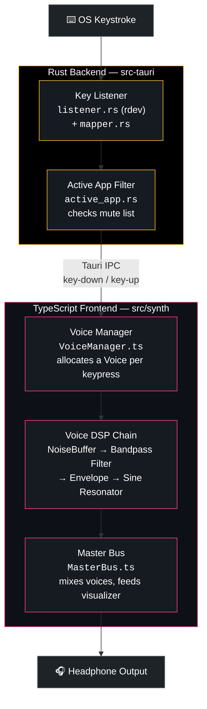

<div align="center">

# 🎛️ Klick

### High-Fidelity Mechanical Keyboard Engine

[](https://tauri.app)
[](https://www.rust-lang.org)
[](https://www.typescriptlang.org)
[](https://vitejs.dev)
[](https://developer.mozilla.org/en-US/docs/Web/API/Web_Audio_API)
[](https://github.com/marbo786/Klick/releases/tag/v0.1.0)
[](LICENSE)

*Every keystroke, synthesized. Real switch acoustics, zero hardware required.*


</div>

---

## 📌 Overview

**Klick** is a premium, opinionated desktop audio utility for mechanical keyboard enthusiasts and audiophiles. It listens for global keystrokes and runs them through a zero-latency WebAudio synthesizer, producing highly realistic, deeply customizable switch acoustics through your headphones — no physical switches required.

Inspired by vintage analog audio receivers and turntable pitch faders, Klick doesn't feel like a settings panel — it feels like a native hardware instrument sitting on your desktop.

**Highlights:**

- 🎹 **Global Key Capture** — Listens for every keystroke system-wide with virtually zero latency
- 🎚️ **Parametric DSP Engine** — Procedural switch audio from white noise bursts, bandpass filters, envelope generators, and sine resonators — no sample libraries
- 🛠️ **Tone Arm Designer** — Live sliders for click (transient) and bottom-out (thock) frequency, resonance, decay, low-pass, and noise mix
- 🔇 **Application Muting** — Auto-mutes when a chosen app (e.g. `Spotify.exe`) is in focus
- 💾 **Preset Management** — 6 tuned built-in profiles, plus save/import/export of custom JSON tuning profiles
- 🚀 **Background Autostart** — Launches silently into the system tray on boot

---

## 🏗️ Architecture

Klick splits responsibility across a Rust-native backend (system-level key listening) and a TypeScript/WebAudio frontend (sound synthesis):



### Module Responsibilities

| # | Module | Role |
|---|--------|------|
| 1 | **Key Listener** (`src-tauri/src/keyboard/listener.rs`) | Uses the `rdev` crate to listen for global keyboard events and forwards them over Tauri IPC |
| 2 | **Key Mapper** (`mapper.rs`) | Translates `rdev` key events into normalized key identifiers |
| 3 | **Active App Tracker** (`active_app.rs`) | Polls the foreground window to enforce per-application muting |
| 4 | **App Controller** (`src/ui/AppController.ts`) | Wires incoming keyboard IPC events to the audio engine and UI |
| 5 | **Voice Manager** (`src/synth/VoiceManager.ts`) | Allocates and releases synth voices per keystroke, pulling parameters from the active preset |
| 6 | **Audio Engine** (`AudioEngine.ts`, `Voice.ts`, `Envelope.ts`, `NoiseBuffer.ts`) | Procedurally synthesizes each click/thock from noise + filters + envelopes |
| 7 | **Master Bus** (`MasterBus.ts`) | Sums all active voices and feeds the waveform visualizer |
| 8 | **Persistence** (`src/storage/persistence.ts`) | Saves, imports, and exports custom tuning profiles as JSON |

---

## 🛠️ Tech Stack

| Layer | Technology |
|-------|-----------|
| **Desktop Shell** | Tauri 2 · native system tray · autostart plugin |
| **Global Input** | Rust · `rdev` · `windows-sys` (foreground app detection) |
| **Audio Synthesis** | WebAudio API · custom parametric DSP (noise, bandpass, envelope, resonance) |
| **Frontend Logic** | TypeScript · Vite 8 |
| **Styling** | Vanilla CSS (token-based design system, no frameworks) |
| **Persistence** | JSON-based preset import/export |

---

## 📂 Project Structure

```
Klick/
├── src-tauri/
│   ├── src/
│   │   ├── keyboard/
│   │   │   ├── listener.rs     # rdev-based global key listener
│   │   │   ├── mapper.rs       # Key event → key identifier mapping
│   │   │   ├── events.rs       # Event payload definitions
│   │   │   ├── active_app.rs   # Foreground app detection for muting
│   │   │   └── mod.rs          # Module wiring + init hook
│   │   ├── lib.rs              # Tauri app setup, command registration
│   │   └── main.rs             # Entry point
│   ├── capabilities/
│   │   └── default.json        # Tauri permission capabilities
│   ├── icons/                  # Cross-platform app icons
│   └── tauri.conf.json         # Window, bundle, and permission config
├── src/
│   ├── synth/
│   │   ├── AudioEngine.ts      # Top-level synthesis orchestrator
│   │   ├── Voice.ts            # Single-keystroke voice (click + thock)
│   │   ├── VoiceManager.ts     # Voice allocation/lifecycle
│   │   ├── Envelope.ts         # ADSR-style envelope generation
│   │   ├── NoiseBuffer.ts      # Procedural white noise source
│   │   ├── MasterBus.ts        # Mix bus + visualizer tap
│   │   ├── KeyProfiles.ts      # Per-key acoustic variation
│   │   └── types.ts            # Shared synth type definitions
│   ├── presets/                # blue · brown · red · silent-red · topre · buckling-spring
│   ├── storage/
│   │   └── persistence.ts      # Preset save/import/export
│   ├── ui/
│   │   ├── AppController.ts    # Binds keyboard IPC events to app state
│   │   ├── Designer.ts         # Tone Arm Designer controls
│   │   ├── InputHandler.ts     # UI input/event wiring
│   │   ├── PresetSelector.ts   # Preset picker
│   │   ├── VolumeControl.ts    # Master volume fader
│   │   └── WaveformVisualizer.ts  # Live waveform rendering
│   ├── main.ts                 # Frontend entry point
│   └── style.css               # Token-based design system
├── public/                     # Static assets
└── index.html
```

---

## 📥 Download

The first public build is available on the [Releases page](https://github.com/marbo786/Klick/releases/tag/v0.1.0):

- **[Klick_0.1.0_x64-setup.exe](https://github.com/marbo786/Klick/releases/download/v0.1.0/Klick_0.1.0_x64-setup.exe)** — Windows installer

> Windows SmartScreen may flag the installer as unrecognized since the app is newly published and unsigned — choose **More Info → Run anyway**.

---

## 🧑‍💻 Usage

1. Launch Klick — it opens as a compact desktop panel and minimizes to the system tray
2. Pick a built-in preset (Cherry MX Blue, Brown, Red, Silent Red, Topre, or Buckling Spring) from the **Preset Selector**
3. Open the **Tone Arm Designer** to fine-tune click/thock frequency, resonance, decay, low-pass, and noise mix live as you type
4. Add applications to the mute list so Klick goes silent while you're in a call or watching a video
5. Save your tuning as a custom preset, or export it as JSON to share

---

## 🎨 Customization

Every preset is a plain TypeScript object describing the click and thock acoustics (`src/presets/`). Duplicate an existing preset, tweak the frequency/resonance/decay/noise-mix parameters, and register it in `src/presets/index.ts` to add your own switch profile.

---

## 🤝 Contributing

Pull requests are welcome. For larger changes, please open an issue first to discuss what you'd like to change.

---

## 👤 Author

**Mohsin** — [@marbo786](https://github.com/marbo786) · [LinkedIn](https://linkedin.com/in/marbo123)

---

<div align="center">

*Built with Tauri · Rust · WebAudio API*

</div>
